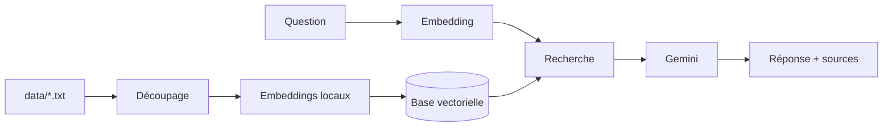

# FitZone RAG Assistant


Assistant en ligne de commande basé sur le **RAG (Retrieval-Augmented Generation)**. Il répond aux questions des clients d'une salle de sport fictive à partir de ses propres documents (tarifs, horaires, règlement) et indique quand l'information est absente, au lieu de l'inventer.

## Fonctionnalités

- Réponses ancrées dans les documents, avec affichage des fichiers sources
- Embeddings calculés en local : indexation gratuite, sans appel API
- Mémoire de conversation pour les questions de suivi
- Seuil de similarité configurable
- Tests de la recherche sans clé API

## Architecture



1. Les fichiers de `data/` sont découpés en morceaux de 500 caractères (chevauchement de 80).
2. Chaque morceau est converti en vecteur avec `all-MiniLM-L6-v2`, puis stocké en mémoire.
3. À chaque question, les 3 morceaux les plus proches (au-dessus du seuil) sont retrouvés.
4. Gemini répond uniquement à partir de ces morceaux.

## Stack

Java 21 · Maven · LangChain4j 1.13.1 · Google Gemini · all-MiniLM-L6-v2 · JUnit 5

## Démarrage rapide

**Prérequis :** JDK 21, Maven (ou un IDE compatible) et une [clé API Gemini](https://aistudio.google.com/).

```bash
git clone https://github.com/TON-PSEUDO/fitzone-rag-assistant.git
cd fitzone-rag-assistant
```

Définir les variables d'environnement, puis lancer la classe `io.github.tonpseudo.fitzonerag.Main` .

| Variable | Obligatoire | Description |
|---|---|---|
| `GEMINI_API_KEY` | Oui | Clé API Gemini (ne jamais la versionner) |
| `GEMINI_MODEL` | Oui | Nom du modèle. Voir les [dépréciations officielles](https://ai.google.dev/gemini-api/docs/deprecations). |
| `RAG_MIN_SCORE` | Non | Score minimal de similarité, entre 0 et 1 (défaut `0.5`) |

## Exemple

```
> Combien coûte la formule Étudiant ?
La formule Étudiant coûte 22 € par mois.
  [source: abonnements.txt]

> Y a-t-il un parking ?
Je n'ai pas cette information.
```

## Structure

```
data/                  Base de connaissances (.txt, UTF-8)
src/main/java/.../
  AppConfig.java       Configuration (variables d'environnement)
  KnowledgeBase.java   Chargement, découpage, embeddings, recherche
  Assistant.java       Interface du chatbot et consigne système
  RagService.java      Gemini + recherche + mémoire
  Main.java            Boucle en console
src/test/java/.../
  RetrievalTest.java   Tests de la recherche
```

## Tests

```bash
mvn test
```

Les tests valident la recherche avec le modèle local, sans appeler Gemini, et affichent les scores de similarité pour ajuster `RAG_MIN_SCORE`.


## Évolutions possibles

- Support des PDF
- Base vectorielle persistante (pgvector)
- API REST Spring Boot et interface web
- Modèle d'embeddings multilingue
